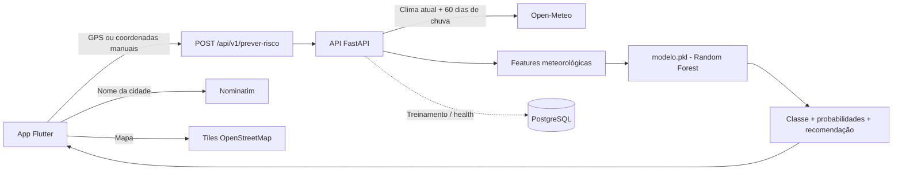

# FireWatch

> **Veja o risco antes do fogo.**

O **FireWatch** é um projeto acadêmico de monitoramento e previsão de risco de queimadas.
O sistema recebe as coordenadas de um local, consulta dados meteorológicos em tempo real,
aplica um modelo de Machine Learning e devolve o nível de risco com probabilidades e
recomendações de prevenção.

O projeto é composto por um **aplicativo mobile em Flutter** e por uma **API em FastAPI**
com um classificador **Random Forest** treinado a partir de dados históricos armazenados
em PostgreSQL.

**Equipe:** G03 — FireWatch  
**Curso:** Desenvolvimento de Software Multiplataforma (DSM) — Fatec Franca  
**Projeto Integrador:** 5º semestre — 2026/2  
**Repositório:** <https://github.com/FatecFranca/DSM-P5-G03-2026-02>

---

## Sumário

- [Sobre o projeto](#sobre-o-projeto)
- [Como funciona](#como-funciona)
- [Funcionalidades](#funcionalidades)
- [Arquitetura](#arquitetura)
- [Tecnologias](#tecnologias)
- [Estrutura do repositório](#estrutura-do-repositório)
- [Executando o projeto](#executando-o-projeto)
- [Configuração do backend](#configuração-do-backend)
- [API](#api)
- [Modelo de Machine Learning](#modelo-de-machine-learning)
- [Testes](#testes)
- [Estado atual e próximos passos](#estado-atual-e-próximos-passos)
- [Equipe](#equipe)

---

## Sobre o projeto

Queimadas e incêndios florestais causam impactos ambientais, econômicos e à saúde da
população. O FireWatch foi desenvolvido para facilitar o acesso a uma estimativa de risco
antes que uma ocorrência aconteça.

A partir de uma latitude e longitude, o sistema:

1. consulta a **Open-Meteo** para obter as condições atuais e o histórico recente de chuva;
2. transforma os dados meteorológicos nas features usadas pelo modelo;
3. aplica um classificador **Random Forest** treinado com dados históricos de risco de fogo;
4. retorna a classe de risco — **Baixo**, **Moderado** ou **Crítico** —, as probabilidades de
   cada classe, uma cor de alerta e uma recomendação;
5. apresenta o resultado no aplicativo, junto com os dados climáticos que sustentam a previsão.

> **Aviso:** o FireWatch é uma ferramenta acadêmica de apoio à informação. Ele não substitui
> os órgãos oficiais de defesa civil, bombeiros ou monitoramento ambiental. Em emergências,
> ligue **193 (Bombeiros)** ou **199 (Defesa Civil)**.

---

## Como funciona



Fluxo resumido:

```text
GPS / coordenadas
        ↓
Open-Meteo (clima atual + histórico de precipitação)
        ↓
Engenharia de features (6 variáveis)
        ↓
Random Forest (3 classes de risco)
        ↓
Risco Baixo / Moderado / Crítico + probabilidades + recomendação
        ↓
Aplicativo Flutter
```

---

## Funcionalidades

### Aplicativo mobile

- **Splash screen** com identidade visual do projeto.
- **Onboarding de localização** com duas opções:
  - solicitar a localização do aparelho via GPS (`geolocator`);
  - informar latitude e longitude manualmente.
- **Tela de monitoramento** (aba "Início"):
  - mapa interativo com tiles do OpenStreetMap centrado nas coordenadas informadas;
  - nome da cidade/estado obtido por geocodificação reversa (Nominatim);
  - painel com temperatura, umidade, precipitação e vento;
  - botão **"Verificar risco aqui"**, que consulta a API real e exibe o resultado.
- **Previsão** com gráficos de temperatura, umidade e evolução do risco por hora e por dia.
- **Mapa de risco** com filtros por nível, legenda e pontos ilustrativos.
- **Alertas** com filtros por severidade e marcação de lidos/não lidos.
- **Prevenção** com orientações de segurança e telefones de emergência.
- **Configurações** de tema claro/escuro, localização e preferências de notificação.
- **Detalhes do risco** com fatores relacionados e gráfico de evolução estimada.
- Suporte a **tema claro e escuro**.

> As telas de previsão, mapa de risco, alertas, prevenção e detalhes do risco ainda usam
> dados demonstrativos. A integração real com a API está implementada no onboarding de
> coordenadas e na tela de monitoramento.

### Backend

- API REST com **FastAPI** e documentação automática em `/docs` e `/redoc`.
- Endpoint de predição a partir de latitude/longitude.
- Consulta à **Open-Meteo** com:
  - cache em memória por coordenada;
  - timeout configurável;
  - repetição automática em falhas de rede e erros `5xx`;
  - modo de fallback offline opcional para desenvolvimento.
- Validação de coordenadas com **Pydantic**.
- Classificação em três níveis com probabilidades, cor e recomendação.
- Health check com estado do modelo e do banco de dados.
- Pool de conexões assíncrono com **asyncpg**.
- CORS configurável por variáveis de ambiente.
- Pipeline de treinamento, reavaliação e busca de hiperparâmetros do modelo.

---

## Arquitetura

O repositório é dividido em dois projetos independentes:

| Projeto | Responsabilidade |
| --- | --- |
| `FirewatchApp/` | Aplicativo mobile em Flutter/Dart |
| `backend/` | API FastAPI, integração com Open-Meteo, acesso ao PostgreSQL e pipeline de ML |

O aplicativo não acessa o banco de dados diretamente. Credenciais e regras de negócio ficam
exclusivamente no backend. A comunicação ocorre por HTTPS com a API, e a API utiliza a
Open-Meteo e o modelo local para produzir a resposta.

A API está configurada para o ambiente de produção em:

```text
https://firewatch-api.chilecentral.cloudapp.azure.com
```

---

## Tecnologias

### Mobile

| Tecnologia | Uso |
| --- | --- |
| **Flutter / Dart** (`SDK >= 3.10`) | Desenvolvimento do aplicativo |
| **Riverpod** | Gerenciamento de estado |
| **go_router** | Navegação e rotas |
| **flutter_map + latlong2** | Mapa interativo |
| **geolocator** | Localização por GPS |
| **http** | Consumo da API |
| **fl_chart** | Gráficos de previsão e evolução do risco |
| **google_fonts / flutter_svg** | Tipografia e ícones vetoriais |

### Backend e Machine Learning

| Tecnologia | Uso |
| --- | --- |
| **Python 3.11+** (validado em 3.13) | Linguagem do backend |
| **FastAPI + Uvicorn** | API HTTP assíncrona |
| **Pydantic v2** | Validação e schemas |
| **asyncpg** | Acesso assíncrono ao PostgreSQL |
| **httpx** | Cliente HTTP para a Open-Meteo |
| **scikit-learn** | Random Forest, métricas e validação cruzada |
| **pandas / numpy / scipy** | Manipulação e análise dos dados |
| **joblib** | Persistência do modelo (`modelo.pkl`) |
| **python-dotenv** | Carregamento do arquivo `.env` |
| **pytest** | Testes automatizados |

### Serviços externos

| Serviço | Uso |
| --- | --- |
| **Open-Meteo** | Clima atual e histórico de precipitação |
| **Nominatim (OpenStreetMap)** | Geocodificação reversa de coordenadas |
| **OpenStreetMap** | Tiles do mapa na tela de monitoramento |
| **PostgreSQL** | Dataset de treinamento e diagnóstico de conexão |

Nenhum desses serviços exige chave de API para as funcionalidades utilizadas.

---

## Estrutura do repositório

```text
DSM-P5-G03-2026-02/
├── backend/
│   ├── app/
│   │   ├── main.py                 # Criação da API, health check e lifespan
│   │   ├── config.py               # Configurações via variáveis de ambiente
│   │   ├── db.py                   # Pool de conexões PostgreSQL
│   │   ├── models/schemas.py       # Schemas de entrada e saída
│   │   ├── routes/risk.py          # Endpoint /api/v1/prever-risco
│   │   └── services/
│   │       ├── weather_service.py  # Integração com a Open-Meteo
│   │       ├── prediction_service.py # Carga e execução do modelo
│   │       └── classificacao.py    # Recomendações e rótulos de risco
│   ├── ml/
│   │   ├── alvo.py                 # Definição das classes e cortes
│   │   ├── dados.py                # Leitura do dataset no PostgreSQL
│   │   ├── features.py             # Engenharia de features
│   │   ├── treinamento.py          # Treino e persistência do modelo
│   │   ├── avaliacao.py            # Avaliação e cenários climáticos
│   │   └── modelo.pkl              # Modelo treinado
│   ├── tests/
│   │   ├── test_api.py
│   │   └── test_fallback.py
│   ├── requirements.txt
│   ├── ruff.toml
│   └── .env.example
└── FirewatchApp/
    ├── lib/
    │   ├── main.dart
    │   ├── app.dart
    │   ├── config/                 # URL da API e ambientes
    │   ├── core/                   # Tema, modelos, roteador e providers
    │   ├── features/               # Telas por funcionalidade
    │   ├── services/               # API, localização e geocodificação
    │   └── shared/widgets/         # Componentes reutilizáveis
    ├── test/
    │   ├── api_service_test.dart
    │   └── widget_test.dart
    ├── pubspec.yaml
    └── README.md
```

---

## Executando o projeto

### Pré-requisitos

- **Flutter** 3.x com Dart `>= 3.10`
- **Python** 3.11 ou superior
- **PostgreSQL** (necessário para treinar o modelo e testar a conexão com o banco)
- Um emulador ou dispositivo para executar o aplicativo

O backend consegue iniciar mesmo sem o banco disponível, mas o endpoint de predição exige
o arquivo `modelo.pkl` carregado. O modelo treinado já está incluído no repositório.

### 1. Backend

No Windows:

```bash
cd backend
python -m venv .venv
.venv\Scripts\activate
pip install -r requirements.txt
copy .env.example .env
python -m uvicorn app.main:app --reload --host 0.0.0.0 --port 8000
```

No Linux/macOS:

```bash
cd backend
python3 -m venv .venv
source .venv/bin/activate
pip install -r requirements.txt
cp .env.example .env
python -m uvicorn app.main:app --reload --host 0.0.0.0 --port 8000
```

Depois de iniciar:

- API: <http://127.0.0.1:8000>
- Documentação Swagger: <http://127.0.0.1:8000/docs>
- Health check: <http://127.0.0.1:8000/health>

Edite o arquivo `backend/.env` com as credenciais do seu PostgreSQL antes de usar os
endpoints que dependem do banco ou de treinar o modelo.

### 2. Treinamento do modelo

Com o banco configurado e a tabela `firewatch_dados` disponível:

```bash
cd backend
python ml/treinamento.py
```

Opções disponíveis:

```bash
python ml/treinamento.py --reavaliar  # reavalia o modelo salvo sem retreinar
python ml/treinamento.py --buscar     # busca de hiperparâmetros com GridSearchCV
python ml/avaliacao.py --cenarios     # métricas, biomas e cenários climáticos
```

### 3. Aplicativo Flutter

```bash
cd FirewatchApp
flutter pub get
flutter run
```

O aplicativo está configurado para consumir a API de produção definida em
`FirewatchApp/lib/config/env_config.dart`:

```dart
static const String apiBaseUrl =
    'https://firewatch-api.chilecentral.cloudapp.azure.com';
```

Para usar um backend local, altere essa constante para o endereço correspondente:

```dart
// Emulador Android
static const String apiBaseUrl = 'http://10.0.2.2:8000';

// Simulador iOS, desktop ou dispositivo físico na mesma rede
static const String apiBaseUrl = 'http://localhost:8000';
```

> Em dispositivos físicos, use o IP da máquina na rede local em vez de `localhost`.
> Para HTTP sem TLS, pode ser necessário ajustar a configuração de segurança de rede
> da plataforma.

---

## Configuração do backend

As configurações são carregadas de `backend/.env` por `pydantic-settings` e
`python-dotenv`. Use `backend/.env.example` como base.

| Variável | Padrão | Descrição |
| --- | --- | --- |
| `OPEN_METEO_URL` | `https://api.open-meteo.com/v1/forecast` | URL da API de clima |
| `OPEN_METEO_TIMEOUT` | `10` | Timeout das requisições, em segundos |
| `CACHE_TTL_SEGUNDOS` | `300` | Tempo de cache do clima por coordenada |
| `PERMITIR_FALLBACK_CLIMA` | `false` | Usa estimativa offline quando a Open-Meteo falha |
| `CORS_ORIGINS` | vazio | Origens web explícitas, separadas por vírgula; sem curingas |
| `RISK_RATE_PER_MINUTE` | `60` | Consultas pontuais por IP/minuto em cada processo |
| `REGIONAL_RATE_PER_MINUTE` | `6` | Consultas regionais por IP/minuto em cada processo |
| `DB_HOST` | `localhost` | Host do PostgreSQL |
| `DB_PORT` | `5432` | Porta do PostgreSQL |
| `DB_NAME` | `firewatch_db` | Nome do banco |
| `DB_USER` | `postgres` | Usuário do banco |
| `DB_PASSWORD` | vazio | Senha do banco |

> O fallback climático é destinado a desenvolvimento e demonstrações offline. Em produção,
> mantenha `PERMITIR_FALLBACK_CLIMA=false` para não mascarar indisponibilidades da fonte real.

---

## API

### Endpoints

| Método | Endpoint | Descrição |
| --- | --- | --- |
| `GET` | `/` | Informações gerais da API |
| `GET` | `/health` | Estado do serviço, do modelo e do banco |
| `POST` | `/api/v1/prever-risco` | Predição de risco para uma coordenada |
| `POST` | `/api/v1/risco-regional` | Até nove zonas de risco com recorte territorial e cache |
| `GET` | `/docs` | Documentação Swagger UI |
| `GET` | `/redoc` | Documentação ReDoc |
| `GET` | `/openapi.json` | Especificação OpenAPI |

### Exemplo de requisição

```bash
curl -X POST http://localhost:8000/api/v1/prever-risco \
  -H "Content-Type: application/json" \
  -d '{"latitude": -20.5386, "longitude": -47.4008}'
```

### Exemplo de resposta

```json
{
  "status": "sucesso",
  "localizacao": {
    "latitude": -20.5386,
    "longitude": -47.4008
  },
  "dados_climaticos": {
    "temperatura": 31.0,
    "umidade_ar": 25.0,
    "precipitacao_mm": 0.0,
    "vento_kmh": 18.0
  },
  "predicao": {
    "probabilidade": 0.87,
    "porcentagem": "87.0%",
    "nivel_risco": "CRÍTICO",
    "classe": "Risco Crítico",
    "cor_alerta": "#DC2626",
    "recomendacao": "Alerta máximo. Evite qualquer tipo de queimada de manejo e reporte focos de fumaça à Defesa Civil.",
    "probabilidades": {
      "risco_baixo": 0.02,
      "risco_moderado": 0.11,
      "risco_critico": 0.87
    }
  }
}
```

> Valores ilustrativos. A resposta real varia conforme as condições meteorológicas do local
> e o resultado do modelo.

### Códigos de erro relevantes

| Status | Situação |
| --- | --- |
| `422` | Coordenadas ausentes, inválidas ou fora dos limites |
| `503` | Open-Meteo indisponível ou modelo não carregado |

---

## Modelo de Machine Learning

### Dataset

O treinamento utiliza a tabela `firewatch_dados` do PostgreSQL, com registros de
**1º de janeiro a 30 de setembro de 2024** (aproximadamente **177.779 registros**).
As colunas meteorológicas chegam padronizadas em z-score com prefixo `avg_` e são
convertidas de volta para unidades físicas durante a leitura.

### Variáveis de entrada

| Feature | Descrição |
| --- | --- |
| `temp_max` | Temperatura máxima do dia (°C) |
| `temp_min` | Temperatura mínima do dia (°C) |
| `umidade` | Umidade relativa do ar (%) |
| `precipitacao_mm` | Precipitação acumulada (mm) |
| `velocidade_vento` | Velocidade do vento (km/h) |
| `dias_sem_chuva` | Dias consecutivos sem chuva |

A ordem das features é canônica e definida em `backend/ml/features.py`. O treinamento e a
inferência importam a mesma definição, garantindo consistência entre as duas etapas.

### Classes de risco

O alvo é derivado do percentil de `risco_fogo`, convertido em um índice de **0 a 100** e
dividido em três classes:

| Índice | Classe | Nível na API | Cor |
| --- | --- | --- | --- |
| `0 – 29,9` | Risco Baixo | `BAIXO` | `#22C55E` |
| `30 – 69,9` | Risco Moderado | `MODERADO` | `#FACC15` |
| `70 – 100` | Risco Crítico | `CRÍTICO` | `#DC2626` |

Os cortes oficiais ficam em `backend/ml/alvo.py` e são compartilhados por treinamento,
avaliação e API.

### Treinamento

- Algoritmo: `RandomForestClassifier`
- Árvores: `300`
- Profundidade máxima: `24`
- Mínimo de amostras por folha: `25`
- Fração de features por divisão: `0.6`
- `random_state`: `42`
- Separação temporal: **80% para treino / 20% para teste**, ordenada por data
- Métricas: accuracy, balanced accuracy, F1 macro, F1 weighted, ROC-AUC OVR, matriz de
  confusão e desempenho por classe
- Validação cruzada: `KFold` com 4 dobras e F1 macro

O modelo treinado é salvo em `backend/ml/modelo.pkl` com metadados: algoritmo, features,
classes, hiperparâmetros, métricas, importâncias das features, data de treinamento e versão
do scikit-learn.

---

## Testes

### Backend

```bash
cd backend
python -m pytest -q
```

A suíte cobre:

- engenharia e normalização das features;
- definição das classes, cortes e rótulos;
- respostas da API, validação de coordenadas e documentação;
- consistência entre classe prevista e probabilidades;
- cache, timeout, retry e fallback da Open-Meteo;
- endpoints de health e teste de banco.

### Aplicativo

```bash
cd FirewatchApp
flutter analyze
flutter test
```

Os testes cobrem:

- navegação da splash para o onboarding e entre as abas;
- preenchimento manual de coordenadas;
- abertura da tela de monitoramento com dados simulados da API;
- mensagens de erro quando a API falha;
- timeout, falhas de rede e respostas inválidas no cliente HTTP.

---

## Estado atual e próximos passos

### Implementado

- Backend FastAPI com predição real e documentação automática.
- Integração com Open-Meteo, cache, retry e fallback configurável.
- Modelo Random Forest treinado, versionado e carregado pela API.
- Aplicativo Flutter com onboarding por GPS ou coordenadas manuais.
- Tela de monitoramento com mapa, clima atual e risco real.
- Testes automatizados no backend e no aplicativo.

### Em evolução

- Substituir os dados demonstrativos das telas de previsão, alertas e mapa de risco por
  dados reais.
- Persistir preferências e alertas do usuário.
- Implementar notificações push.
- Ampliar a cobertura de testes de interface.
- Adicionar autenticação e histórico de consultas.
- Automatizar o deploy e a integração contínua.

---

## Equipe

**Equipe G03 — FireWatch**

| Integrante |
| --- |
| **Iago Pinheiro Rodrigues** |
| **Kaio Leandro Rissato** |
| **Pedro Henrique Xavier Constancio** |

Projeto desenvolvido para o **Projeto Integrador do 5º semestre** do curso de
**Desenvolvimento de Software Multiplataforma (DSM)** da **Fatec Franca**, turma **2026/2**.

---

Projeto acadêmico desenvolvido para fins educacionais.
