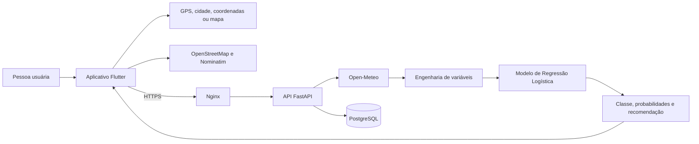

# FireWatch

> Veja o risco antes do fogo.

O **FireWatch** é um projeto acadêmico de monitoramento e previsão de risco de queimadas. A solução foi desenvolvida como Projeto Integrador do curso de Desenvolvimento de Software Multiplataforma da Fatec Franca.

**Equipe:** G03 — FireWatch  
**Curso:** Desenvolvimento de Software Multiplataforma (DSM) — Fatec Franca  
**Projeto Integrador:** 5º semestre — 2026/2  
**Repositório:** [FatecFranca/DSM-P5-G03-2026-02](https://github.com/FatecFranca/DSM-P5-G03-2026-02)

[](https://github.com/FatecFranca/DSM-P5-G03-2026-02/actions/workflows/validacao.yml)
[](https://github.com/FatecFranca/DSM-P5-G03-2026-02/releases/latest)

> **Aviso:** o FireWatch é uma ferramenta acadêmica de apoio à informação. Ele não substitui órgãos oficiais de defesa civil, bombeiros ou monitoramento ambiental. Em emergências, ligue **193 (Bombeiros)** ou **199 (Defesa Civil)**.

---

## Sumário

- [Sobre o projeto](#sobre-o-projeto)
- [Como funciona](#como-funciona)
- [Funcionalidades](#funcionalidades)
- [Baixe o aplicativo](#baixe-o-aplicativo)
- [Arquitetura](#arquitetura)
- [Tecnologias](#tecnologias)
- [Estrutura do repositório](#estrutura-do-repositório)
- [Executando o projeto](#executando-o-projeto)
- [Configuração do backend](#configuração-do-backend)
- [API](#api)
- [Modelo de aprendizado de máquina](#modelo-de-aprendizado-de-máquina)
- [Testes](#testes)
- [Estado atual e limitações](#estado-atual-e-limitações)
- [Equipe](#equipe)

---

## Sobre o projeto

Queimadas e incêndios florestais causam impactos ambientais, econômicos e à saúde da população. O FireWatch foi desenvolvido para facilitar o acesso a uma estimativa de risco antes que uma ocorrência aconteça.

A partir de uma localização escolhida pela pessoa usuária, o sistema:

1. consulta condições meteorológicas atuais e o histórico recente de precipitação;
2. transforma os dados nas variáveis esperadas pelo modelo;
3. aplica uma Regressão Logística com balanceamento de classes;
4. classifica o risco como **Baixo**, **Moderado** ou **Crítico**;
5. apresenta probabilidades, condições climáticas e uma recomendação de prevenção no aplicativo.

O projeto reúne um aplicativo Android em Flutter, uma API em FastAPI, um banco PostgreSQL com o histórico oficial e um modelo de aprendizado de máquina. A aplicação está disponível de ponta a ponta e possui uma versão Android assinada.

## Como funciona



O aplicativo nunca acessa o PostgreSQL diretamente. A API concentra as regras de negócio, a validação das entradas, as consultas ao banco e a execução do modelo.

## Funcionalidades

### Aplicativo Android

- seleção da localização por GPS, busca de cidade, coordenadas ou toque no mapa;
- consulta pontual de risco com temperatura, umidade, precipitação e vento;
- análise regional experimental com até nove zonas;
- mapa interativo baseado no OpenStreetMap;
- orientação baseada na última consulta real, sem alertas fictícios;
- conteúdo de prevenção e contatos de emergência;
- temas claro e escuro;
- estados de carregamento, indisponibilidade e nova tentativa;
- layouts responsivos e recursos de acessibilidade.

### Backend

- API assíncrona com FastAPI;
- consulta meteorológica à Open-Meteo;
- classificação em Risco Baixo, Moderado ou Crítico;
- probabilidades, cor de alerta e recomendação para cada resultado;
- análise regional limitada ao território brasileiro;
- cache meteorológico, timeout, repetição controlada e limitação de requisições;
- verificação de saúde do serviço, modelo, banco e dataset;
- filtros, paginação e estatísticas do histórico;
- pool de conexões PostgreSQL dimensionado para uma VM de baixo custo.

### Dados e aprendizado de máquina

- 157.682 registros históricos entre 1º de janeiro e 9 de setembro de 2024;
- dataset oficial preservado no PostgreSQL sem reclassificação durante a importação;
- importação validada, transacional e segura para reexecução;
- Regressão Logística com balanceamento de classes;
- validação do artefato do modelo antes da primeira previsão.

O dataset e o artefato do modelo não ficam no Git. Cada ambiente recebe esses arquivos separadamente por um canal seguro.

## Baixe o aplicativo

A versão atual é distribuída como Android Package Kit (APK) e requer Android 7.0 ou superior:

- [Baixar o APK do FireWatch](https://github.com/FatecFranca/DSM-P5-G03-2026-02/releases/download/v1.0.0/firewatch-v1.0.0.apk)
- [Consultar as notas da versão](https://github.com/FatecFranca/DSM-P5-G03-2026-02/releases/tag/v1.0.0)

O APK de produção se comunica com a API por HTTPS. A máquina virtual da Azure opera sob demanda para reduzir custos. Quando ela está desalocada, o aplicativo abre normalmente, mas não consegue realizar novas consultas de risco.

## Arquitetura

O repositório possui dois projetos principais:

| Projeto | Responsabilidade |
| --- | --- |
| `FirewatchApp/` | Aplicativo Android desenvolvido em Flutter e Dart |
| `backend/` | API FastAPI, integração meteorológica, acesso ao PostgreSQL e inferência do modelo |

### Ambiente de produção

A implantação usa uma única máquina virtual Ubuntu na Microsoft Azure para manter a solução simples e econômica:

| Componente | Responsabilidade |
| --- | --- |
| Nginx | HTTPS, proxy reverso, cabeçalhos de segurança e limites de acesso |
| FastAPI e Uvicorn | API e execução do modelo |
| PostgreSQL | Dataset histórico e consultas agregadas |
| systemd | Inicialização e recuperação automática dos serviços |

O PostgreSQL aceita conexões apenas no endereço local da VM. A internet acessa somente os serviços web necessários, e o acesso administrativo é restrito.

O deploy não acompanha automaticamente cada alteração no GitHub. Mudanças no backend precisam ser implantadas e validadas explicitamente antes da reinicialização do serviço.

## Tecnologias

| Camada | Tecnologias |
| --- | --- |
| Aplicativo | Flutter, Dart, Riverpod, go_router, flutter_map e geolocator |
| API | Python, FastAPI, Uvicorn, Pydantic, HTTPX e asyncpg |
| Aprendizado de máquina | scikit-learn, pandas, NumPy, SciPy e joblib |
| Dados | PostgreSQL |
| Produção | Ubuntu, Nginx, systemd, Let's Encrypt e Microsoft Azure |
| Qualidade | pytest, Flutter Test, Ruff e GitHub Actions |

## Estrutura do repositório

```text
DSM-P5-G03-2026-02/
├── .github/workflows/       # Validação contínua
├── backend/
│   ├── app/                 # API, rotas, modelos e serviços
│   ├── docs/                # Documentação técnica do backend
│   ├── migrations/          # Estrutura versionada do PostgreSQL
│   ├── ml/                  # Pipeline e contrato do modelo
│   ├── scripts/             # Migração e importação do dataset
│   └── tests/               # Testes do backend
├── FirewatchApp/
│   ├── android/             # Configuração da plataforma Android
│   ├── lib/                 # Código do aplicativo Flutter
│   └── test/                # Testes do aplicativo
└── README.md
```

## Executando o projeto

### Pré-requisitos

- Python 3.11 ou superior;
- PostgreSQL 16 ou compatível;
- Flutter com uma versão compatível com o projeto;
- dataset preprocessado em formato CSV;
- artefato compatível do modelo em formato joblib.

### Backend

Crie o ambiente virtual e instale as dependências:

```bash
cd backend
python3 -m venv .venv
source .venv/bin/activate
python -m pip install -r requirements.txt
cp .env.example .env
```

Configure o `.env` com a conexão PostgreSQL e o caminho do modelo. Não versione esse arquivo.

Crie o schema e importe o dataset:

```bash
python -m scripts.aplicar_migrations
python -m scripts.importar_dataset \
  --arquivo "/caminho/para/dataset_preprocessado.csv"
```

Inicie a API:

```bash
python -m uvicorn app.main:app --reload --host 127.0.0.1 --port 8000
```

Depois da inicialização, acesse:

- API local: [http://127.0.0.1:8000](http://127.0.0.1:8000);
- Swagger UI: [http://127.0.0.1:8000/docs](http://127.0.0.1:8000/docs);
- verificação de saúde: [http://127.0.0.1:8000/health](http://127.0.0.1:8000/health).

O backend inicia em modo degradado quando o banco ou o modelo não estão disponíveis. Os endpoints dependentes desses componentes informam a indisponibilidade sem inventar resultados.

### Aplicativo Flutter

Instale as dependências e inicie o aplicativo:

```bash
cd FirewatchApp
flutter pub get
flutter run
```

O build padrão usa a API de produção por HTTPS. Para usar o backend local no emulador Android:

```bash
flutter run \
  --dart-define=APP_ENVIRONMENT=development \
  --dart-define=API_BASE_URL=http://10.0.2.2:8000
```

Em um dispositivo físico, substitua `10.0.2.2` pelo endereço da máquina na rede local. Builds de produção aceitam apenas a API HTTPS configurada.

## Configuração do backend

Copie `backend/.env.example` e ajuste somente os valores necessários:

| Variável | Finalidade |
| --- | --- |
| `MODEL_PATH` | Caminho local do artefato do modelo |
| `DB_HOST`, `DB_PORT` e `DB_NAME` | Destino do PostgreSQL |
| `DB_USER` e `DB_PASSWORD` | Credenciais do banco |
| `DB_POOL_MIN` e `DB_POOL_MAX` | Limites do pool de conexões |
| `OPEN_METEO_TIMEOUT` | Timeout da consulta meteorológica |
| `CACHE_TTL_SEGUNDOS` | Validade do cache meteorológico |
| `PERMITIR_FALLBACK_CLIMA` | Fallback exclusivo para desenvolvimento |
| `CORS_ORIGINS` | Origens web autorizadas |
| `RISK_RATE_PER_MINUTE` | Limite da previsão pontual |
| `REGIONAL_RATE_PER_MINUTE` | Limite da análise regional |

Mantenha `PERMITIR_FALLBACK_CLIMA=false` em produção para não apresentar estimativas locais como dados meteorológicos reais.

## API

| Método | Endpoint | Descrição |
| --- | --- | --- |
| `GET` | `/` | Identificação e rotas principais |
| `GET` | `/health` | Estado da API, modelo, banco e dataset |
| `POST` | `/api/v1/prever-risco` | Risco pontual por coordenadas |
| `POST` | `/api/v1/risco-regional` | Amostragem regional com até nove zonas |
| `GET` | `/api/v1/dados` | Histórico filtrado e paginado |
| `GET` | `/api/v1/dados/estatisticas` | Estatísticas do dataset |
| `GET` | `/docs` | Swagger UI |
| `GET` | `/redoc` | ReDoc |

Exemplo de previsão em um backend local:

```bash
curl --request POST http://127.0.0.1:8000/api/v1/prever-risco \
  --header "Content-Type: application/json" \
  --data '{"latitude":-20.5386,"longitude":-47.4008}'
```

A API retorna as condições meteorológicas, a classe prevista, as probabilidades das três classes, uma cor de alerta e uma recomendação.

## Modelo de aprendizado de máquina

O FireWatch utiliza uma Regressão Logística com balanceamento de classes. O modelo recebe quatro variáveis:

- média do número de dias sem chuva;
- precipitação estimada em milímetros;
- componente seno do dia do ano;
- componente cosseno do dia do ano.

O histórico oficial contém 157.682 registros entre 1º de janeiro e 9 de setembro de 2024 e é armazenado na tabela `firewatch_preprocessado`. A importação preserva os valores finais do dataset, sem recalcular sua classificação.

O artefato treinado é externo ao Git. O backend valida sua compatibilidade antes de aceitar previsões e não realiza retreinamento durante a inicialização ou o deploy.

## Testes

### Backend

```bash
cd backend
source .venv/bin/activate
python -m pytest -q
```

O teste de integração com o dataset importado é opcional e exige um PostgreSQL configurado:

```bash
FIREWATCH_TEST_DATABASE=1 \
  python -m pytest -q tests/test_dataset_integration.py
```

### Aplicativo

```bash
cd FirewatchApp
dart format --output=none --set-exit-if-changed lib test
flutter analyze
flutter test
```

O workflow de validação executa as suítes do backend e do aplicativo em cada push e pull request.

## Estado atual e limitações

### Implementado

- aplicativo Android integrado à API de produção;
- API FastAPI com predição pontual e regional;
- PostgreSQL com o dataset histórico oficial;
- comunicação pública protegida por HTTPS;
- APK de produção assinado e publicado no GitHub Releases;
- validação automatizada do backend e do aplicativo.

### Limitações e uso responsável

- a classificação é uma estimativa acadêmica, não uma confirmação de incêndio;
- a análise regional usa previsões pontuais e não representa um perímetro de fogo;
- a aba de alertas apresenta a última consulta da sessão e não envia notificações push;
- a disponibilidade depende da VM e dos serviços externos utilizados;
- os tiles públicos do OpenStreetMap atendem ao contexto acadêmico atual, não a uma operação de grande escala.

## Equipe

**Equipe G03 — FireWatch**

| Integrante |
| --- |
| Iago Pinheiro Rodrigues |
| Kaio Leandro Rissato |
| Pedro Henrique Xavier Constancio |

Projeto desenvolvido para o **Projeto Integrador do 5º semestre** do curso de **Desenvolvimento de Software Multiplataforma (DSM)** da **Fatec Franca**, turma **2026/2**.

---

Projeto acadêmico desenvolvido para fins educacionais.
